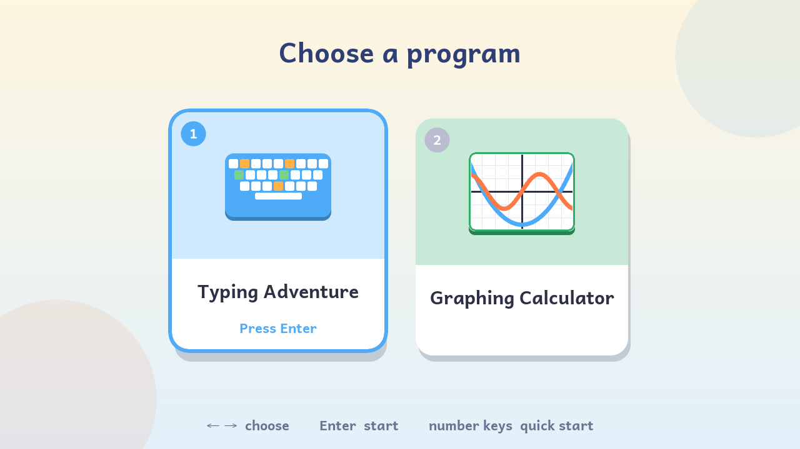
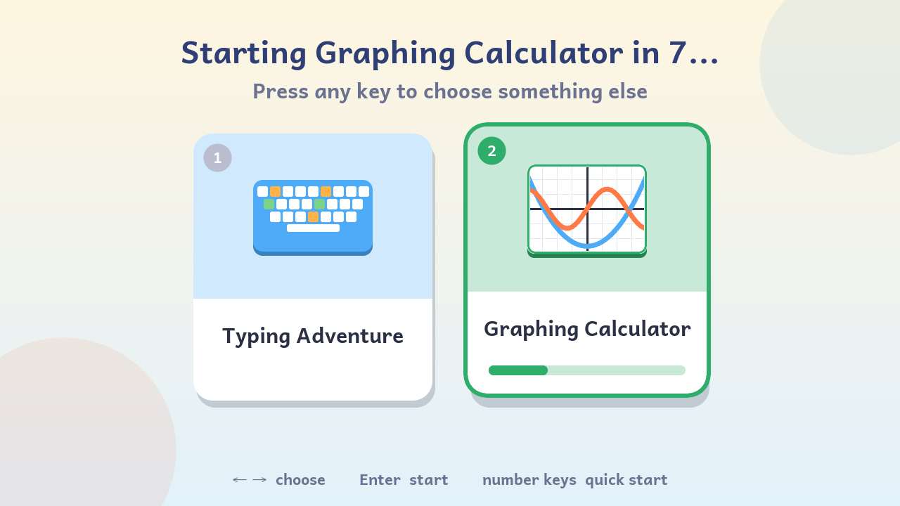

# Pi Launcher

A boot menu for **bare-metal Raspberry Pi 3 B+ programs**. One SD card holds
several programs, such as [Typing Adventure](https://github.com/meelash/pi-typing)
and the [Graphing Calculator](https://github.com/meelash/pi-graphcalc), and the
menu starts the one a child picks. Like the programs, the menu runs with **no
operating system**.

| Menu | After power-on |
|---|---|
|  |  |

## How it works

The Pi's firmware can only start one kernel, `kernel8.img`, and the Pi 3 B+
has no boot-partition switching. So the menu **is** that kernel:

1. The firmware starts the menu. It brings up the screen, the SD card and the
   USB keyboard, and lists the programs in `apps/apps.txt`.
2. When a program is chosen, the menu reads its image (`apps/typing.img`, ...)
   into memory, shuts down the USB controller and the ARM timer, and calls
   Circle's `EnableChainBoot()`. Circle then copies the image to `0x80000` and
   jumps to it, so the program starts exactly as if the firmware had started it.
3. A program goes back to the menu by writing `apps/show-menu` and rebooting.
   The menu sees the file, deletes it and waits for a choice.
4. After a power-on (no `apps/show-menu`), the menu starts the program used
   last (`apps/last.txt`) after `autostart` seconds, unless a key is pressed.
   No keyboard is needed for that.

Programs are ordinary bare-metal kernels. A program only needs two things to
come back to the menu: check that `apps/apps.txt` exists (then show a "menu"
key), and to go back, write `apps/show-menu` and return `EXIT_REBOOT` from
`main()`. See `HasMenu()` and `ReturnToMenu()` in pi-typing's `src/pi/kernel.cpp`.

### The timer interrupt left running

Circle's `CTimer::Initialize()` routes the ARM generic timer's interrupt to the
CPU before it sets the tick length (`m_nClockTicksPerHZTick`). After a cold boot
the timer is off, so this is harmless. After a chain boot, a timer still running
from the menu fires at once, and the handler re-arms it with a step of 0, so it
fires forever: the program hung in `CTimer::Initialize()` (found in QEMU). The
menu therefore stops the timer (`CNTP_CTL_EL0 = 0`) before handing over.

## The SD card

| File | What it is |
|---|---|
| `kernel8.img` | The menu (about 600 KB) |
| `apps/apps.txt` | The programs in the menu, and the autostart time (parents can edit it) |
| `apps/typing.img`, `apps/graphcalc.img` | The programs: each one's own `kernel8.img`, renamed |
| `apps/last.txt`, `apps/show-menu` | Written by the menu and the programs |
| `progress.txt`, `graphcalc/` | Each program's saved work, as on its own card |
| `bootcode.bin`, `start.elf`, `fixup.dat`, `LICENCE.broadcom` | Raspberry Pi GPU firmware |
| `config.txt`, `cmdline.txt` | Boot settings, shared by all programs |

`apps/apps.txt`:

```
autostart=10
app=typing.img|Typing Adventure|keyboard
app=graphcalc.img|Graphing Calculator|graph
```

Icons: `keyboard`, `graph`, `write`, `star`. Up to 8 programs; the number keys
start them directly. A program up to 8 MB can be started (the menu's
`--kernel-max-size`).

## Security model

The same as the programs: built with [Circle](https://github.com/rsta2/circle),
with only the HDMI framebuffer, the USB host controller with the keyboard driver,
and the SD card with FAT linked in. No networking, Wi-Fi, Bluetooth or other USB
classes; the kernel was checked for their symbols. The menu only starts files
from the card's `apps` folder that begin like an AArch64 kernel.

## Building

The programs are built from their own repositories, checked out next to this one:

```
git clone --recursive https://github.com/meelash/pi-launcher
git clone --recursive https://github.com/meelash/pi-typing
git clone --recursive https://github.com/meelash/pi-graphcalc
cd pi-launcher
make          # build/pi-apps.img: the menu and both programs
```

| Target | What it does |
|---|---|
| `make` | SD card image `build/pi-apps.img` |
| `make sdcard` | Card files in `build/sdcard/` |
| `make kernel` | Just the menu |
| `make sdcard PREBUILT=dir` | Use ready-made program images from `dir` (`typing.img`, ...) |
| `make APPS="typing:../pi-typing"` | Choose which programs go on the card |
| `make test` | Simulator tests (screenshots in `build/shots/`) |
| `make qemu` | The whole card for `qemu-system-aarch64 -M raspi3b`, programs included |
| `make debug` | Menu with extra USB logging |

`make qemu` then `scripts/qemu-run.sh` boots the card in QEMU. Drive it with
`scripts/qemu-drive.py build/qemu key:ret wait:5 shot:screen`.

## Licences

Andika font: SIL Open Font License 1.1 (`assets/fonts/OFL-Andika.txt`).
Circle: GPL-3.0. Raspberry Pi firmware: see `LICENCE.broadcom` on the card.
